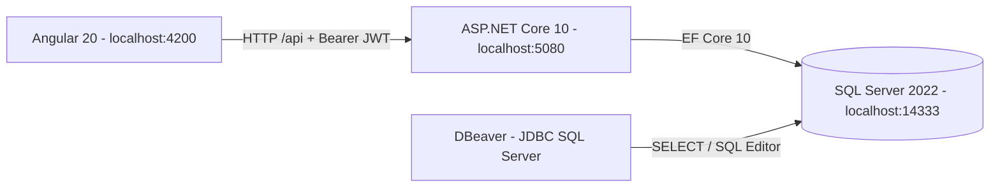
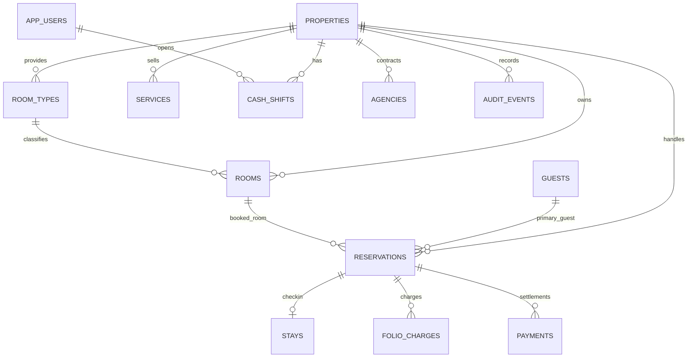
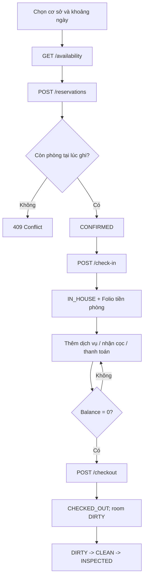

# Kiến trúc và luồng dữ liệu

## Entity quan trọng

## Các trạng thái thiết kế độc lập

- `reservation.status`: `CONFIRMED`, `CHECKED_IN`, `CHECKED_OUT`, `CANCELLED`.
- `stay.status`: `IN_HOUSE`, `CHECKED_OUT`.
- `room.housekeeping_status`: `DIRTY`, `CLEAN`, `INSPECTED`.
- `room.is_out_of_order`: cờ bảo trì, chặn bán.
- `cash_shift.status`: `OPEN`, `CLOSED`.
- `payment.kind`: `DEPOSIT`, `PAYMENT`.

## Mẫu luồng chuẩn

**Lưu ý riêng bản demo:** ghi tiền phòng theo cả kỳ tại check-in; chưa có night audit và doanh thu phân bổ từng ngày. Checkout phải cân bằng tuyệt đối; chưa có refund cho số dư âm. Cần bổ sung các nghiệp vụ này trước khi đưa sản phẩm vào vận hành thật.
